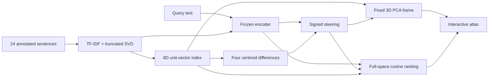

# EIDOLON VECTOR-X

**Engineering the Geometry of Meaning.**

RESURRECT 2026 | Problem Statement 05

Team EIDOLON · Skanda MP · Vani Bhat · Y Nayana · Kavana Y M

## Research question

How does moving a query toward a concept change what it retrieves? VECTOR-X embeds a sentence, ranks a fixed corpus, then lets the operator steer the same query and inspect which documents move up or down.



## Mathematics

The trained CPU baseline uses TF–IDF and seeded truncated SVD to produce a unit query vector $x$. Each topic direction $d$ is the normalized difference between its mean embedding and the mean of the other three topics. The slider computes $y = (x + a d)/\|x + a d\|_2$ for signed strength $a$ between −2 and +2. Scores are dot products against unit document vectors. One centered PCA frame displays the corpus and 25 samples along the normalized steering path.

## Review status

| Feature | Status | Operator capability |
| --- | --- | --- |
| Semantic Universe | IN PROGRESS | Orbit, zoom, reset and select actual corpus points |
| Vector Warp | IN PROGRESS | Signed control, animated trajectory and cosine |
| Semantic X-Ray | IN PROGRESS | Compare full-space top-three neighbors |
| Concept DNA preview | IMPLEMENTED | Steer toward or away from astronomy, ocean, acoustics or botany |
| Mission Control | IMPLEMENTED | Inspect live model identity, dimensions and API availability |

## Run locally

Use Python 3.12, uv, Node 24 and npm. Install Google Chrome for browser verification.

```sh
./scripts/start
./scripts/verify
./scripts/stop
```

Start installs missing locked dependencies, fits the local model and enables Vite hot reload and Uvicorn reload. Open the [atlas](http://localhost:5173) or [API health](http://localhost:8000/api/v1/health). The stack uses React, TypeScript, Three.js, FastAPI, NumPy and scikit-learn. The atlas renders perspective-projected marks in SVG using Three.js camera math. The overview also uses React Three Fiber. Local logs and smoke screenshots live in the ignored runtime directory.

## Three-phase roadmap

1. **IN PROGRESS · Interactive baseline.** Recover and verify the local steering workbench. The recovery run passed 18 model and live HTTP tests.
2. **PLANNED · Learned control.** Trainable directions, Semantic Lock, constrained and multi-concept steering, Drift Guardian and Parallel Universes.
3. **PLANNED · Evaluation and delivery.** Held-out comparisons, ablations, stress tests, projection fidelity, Evidence Vault, Vercel/Railway deployment and final demonstration.

## Scientific limits

The 24 authored English sentences serve as fit data and retrieval candidates. Shared vocabulary can dominate results. Unknown-only queries are rejected. The model is a lexical LSA baseline. Three-dimensional proximity is approximate. Generalization, neutral preservation and deployment remain unverified.

The evaluation protocol groups source families before splitting, fits transforms on training only, selects thresholds on validation and freezes settings before held-out evaluation. [Research design](docs/RESEARCH.md) · [Build record](BUILD_STATE.md)
