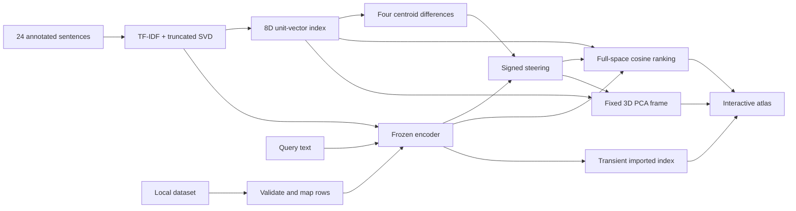

# EIDOLON VECTOR-X

**Engineering the Geometry of Meaning.**

RESURRECT 2026 | Problem Statement 05

Team EIDOLON · Skanda MP · Vani Bhat · Y Nayana · Kavana Y M

## Research question

How does moving a query toward a concept change what it retrieves? VECTOR-X embeds a sentence, ranks a fixed corpus, then lets the operator steer the same query and inspect which documents move up or down.



## Mathematics

The trained CPU baseline uses TF–IDF and seeded truncated SVD to produce a unit query vector $x$. Each topic direction $d$ is the normalized difference between its mean embedding and the mean of the other three topics. The slider computes $y = (x + a d)/\|x + a d\|_2$ for signed strength $a$ between −2 and +2. Scores are dot products against unit document vectors. One centered PCA frame displays the corpus and 25 samples along the normalized steering path.

## Review status

| Feature | Status | Operator capability |
| --- | --- | --- |
| Semantic Universe | VERIFIED | Search, orbit, zoom, reset and select actual corpus points |
| Vector Warp | VERIFIED | Signed control, animated trajectory, cosine and L2 displacement |
| Semantic X-Ray | VERIFIED | Inspect every query coefficient and compare top-three neighbors |
| Concept DNA preview | VERIFIED | Steer toward or away from astronomy, ocean, acoustics or botany |
| Mission Control | VERIFIED | Inspect live model identity, dimensions and API availability |
| Data Foundry | VERIFIED | Import local files, map columns, inspect fixed PCA coordinates, steer and export retrieval |

## Import a dataset

Open **Data Foundry** and drop a UTF-8 CSV (header row), JSON (array of flat objects), JSONL (one object per line) or TXT (one record per line). Choose a text field and any metadata, then generate embeddings. The progress counter advances after each completed batch of up to 64. Select an embedded row, change its direction and compare the ranked results.

Imports accept up to 10,000,000 bytes, 5,000 records, 32 columns and 4,096 characters per cell. Empty text and exact duplicate parsed records are skipped. Unknown-only records are counted as unrepresented. The frozen encoder and PCA frame match the calibration atlas. The original and steered rankings include the source row.

Data passes through a loopback API with one active Foundry operation per worker. Only the active view retains the index. Delete, reload or leave the view to release it. Cancelling discards partial results and prevents subsequent batches. An in-flight bounded server operation may finish. CSV export creates a local file and quotes formula-leading text. Delete exported files separately.

## Run locally

Use Python 3.12, uv, Node 24 and npm. Install Google Chrome for browser verification.

```sh
./scripts/start
./scripts/verify
./scripts/stop
```

Start installs missing locked dependencies, fits the local model and enables Vite hot reload and Uvicorn reload. Open the [atlas](http://localhost:5173) or [API health](http://localhost:8000/api/v1/health). The stack uses React, TypeScript, Three.js, FastAPI, NumPy and scikit-learn. The atlas renders perspective-projected marks in SVG using Three.js camera math. The overview also uses React Three Fiber. Local logs and smoke screenshots live in the ignored runtime directory.

## Three-phase roadmap

1. **VERIFIED · Interactive baseline.** 27 model, parser and HTTP tests passed, plus TypeScript, Vite build and desktop/mobile Chrome smoke. [Phase 1 evidence and demonstration](REVIEW_PHASE_1.md)
2. **PLANNED · Learned control.** Trainable directions, Semantic Lock, constrained and multi-concept steering, Drift Guardian and Parallel Universes. Foundry roadmap includes dataset fingerprints, model-keyed caching, dataset management, quality reports, learned concepts, multi-model comparison and vector export.
3. **PLANNED · Evaluation and delivery.** Held-out comparisons, ablations, stress tests, projection fidelity, Evidence Vault, Vercel/Railway deployment and final demonstration. Foundry adds split management and reproducible experiment exports. PDF/NPY imports are optional.

## Scientific limits

The 24 authored English sentences serve as fit data and retrieval candidates. Shared vocabulary can dominate results. Unknown-only queries are rejected. The model is a lexical LSA baseline. Three-dimensional proximity is approximate. Generalization, neutral preservation and deployment remain unverified.

The evaluation protocol groups source families before splitting, fits transforms on training only, selects thresholds on validation and freezes settings before held-out evaluation. [Research design](docs/RESEARCH.md) · [Build record](BUILD_STATE.md)
