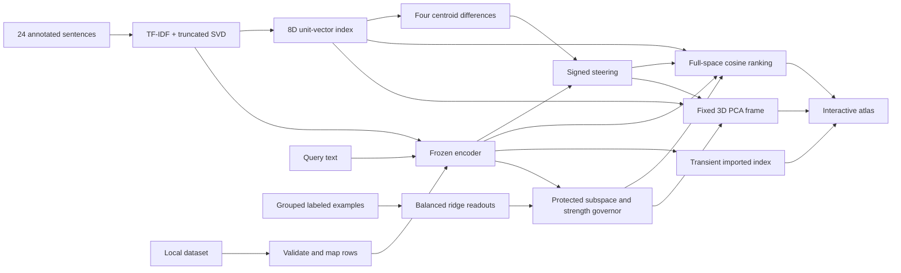

# EIDOLON VECTOR-X

**Engineering the Geometry of Meaning.**

RESURRECT 2026 | Problem Statement 05

Team EIDOLON · Skanda MP · Vani Bhat · Y Nayana · Kavana Y M

## Convergence production release

Open [public Mission Control](https://eidolon-vector-x.vercel.app/#mission-control) to explore all six workspaces. The [Railway health endpoint](https://vector-x-backend-production.up.railway.app/api/v1/health) reports service readiness. Public inference uses the 8D calibration encoder. Use the [local workspace](http://localhost:5173/#mission-control) for private dataset imports, concept training and the four research encoders.

The engineering release preserves the individual milestones from [PR #1](https://github.com/skandamp-sudo/EIDOLON-VECTOR-X/pull/1). See [the release record](BUILD_STATE.md#convergence-production-release) and [the scientific results and limits](docs/CONVERGENCE.md).

[Judge walkthrough and local fallback](docs/JUDGE-WALKTHROUGH.md) · [Independent evaluation instructions](docs/INDEPENDENT-EVALUATION.md)

## Research question

How does moving a query toward a concept change what it retrieves? VECTOR-X embeds a sentence, ranks a fixed corpus, then lets the operator steer the same query and inspect which documents move up or down.



## Mathematics

The trained CPU baseline uses TF–IDF and seeded truncated SVD to produce a unit query vector $x$. Each topic direction $d$ is the normalized difference between its mean embedding and the mean of the other three topics. The slider computes $y = (x + a d)/\|x + a d\|_2$ for signed strength $a$ between −2 and +2. Scores are dot products against unit document vectors. One centered PCA frame displays the corpus and 25 samples along the normalized steering path.

## Review status

| Feature | Status | Operator capability |
| --- | --- | --- |
| Semantic Universe | VERIFIED | Search, orbit, zoom, reset and select actual corpus points |
| Vector Warp | VERIFIED | Signed control, animated trajectory, cosine and L2 displacement |
| Semantic X-Ray | VERIFIED | Inspect every query coefficient and compare top-three neighbors |
| Concept DNA preview | VERIFIED | Steer toward or away from astronomy, ocean, acoustics or botany |
| Mission Control | VERIFIED | Inspect live model identity, dimensions and API availability |
| Data Foundry | VERIFIED | Map and switch local datasets, reuse embeddings, inspect quality, export vectors and retrieval |
| Concept DNA and Semantic Lock | VERIFIED | Learn a custom direction, choose protected readouts and compare four transformations |
| Parallel Universes and Semantic Debugger | VERIFIED | Inspect synchronized views, projection distortion, rank changes and suspected anomalies |

## Import a dataset

Open **Data Foundry** and drop a UTF-8 CSV (header row), JSON (array of flat objects), JSONL (one object per line) or TXT (one record per line). Choose a text field and any metadata, then generate embeddings. The progress counter advances after each completed batch of up to 64. Select an embedded row, change its direction and compare the ranked results.

Imports accept up to 10,000,000 bytes, 5,000 records, 32 columns and 4,096 characters per cell. Empty text and exact duplicate parsed records are skipped. Unknown-only records are counted as unrepresented. The frozen encoder and PCA frame match the calibration atlas. The original and steered rankings include the source row.

Data passes through a loopback API with one active Foundry operation per worker. The Foundry view holds up to two datasets in memory. Each retains one completed index keyed by file SHA-256, format, mapped text column and fitted model identity. Switch datasets to reuse the index. Delete a dataset to release its parser output and cache. Reloading or leaving Foundry releases both datasets. Cancelling discards partial results and prevents subsequent batches. An in-flight bounded server operation may finish. The quality report records missing fields, duplicates and coverage. The JSON vector export contains original and topic-steered embeddings for every represented row. CSV retrieval export escapes formula-leading cells. Exports are local downloads with independent lifetimes.

## Run locally

Use Python 3.12, uv, Node 24 and npm. Install Google Chrome for browser verification.

```sh
./scripts/start
./scripts/verify
./scripts/stop
```

Start installs missing locked dependencies, fits the local model and enables Vite hot reload and Uvicorn reload. Open the [atlas](http://localhost:5173) or [API health](http://localhost:8000/api/v1/health). The stack uses React, TypeScript, Three.js, FastAPI, NumPy and scikit-learn. The atlas renders perspective-projected marks in SVG using Three.js camera math. The overview also uses React Three Fiber. Local logs and smoke screenshots live in the ignored runtime directory.

## Three-phase roadmap

1. **VERIFIED · Interactive baseline.** 27 model, parser and HTTP tests passed, plus TypeScript, Vite build and desktop/mobile Chrome smoke. [Phase 1 evidence and demonstration](REVIEW_PHASE_1.md)
2. **VERIFIED · Learned control.** Class-balanced ridge directions, Semantic Lock, a measured strength governor, change analysis, projection diagnostics and synchronized Parallel Universes. [Phase 2 evidence and demo](REVIEW_PHASE_2.md) The review gate passed 35 Python tests, TypeScript, Vite and desktop/mobile Chrome checks. Multi-model comparison is deferred pending a second compatible encoder.
3. **PLANNED · Evaluation and delivery.** Held-out comparisons, ablations, stress tests, projection fidelity, Evidence Vault, Vercel/Railway deployment and final demonstration. Foundry adds split management and reproducible experiment exports. PDF/NPY imports are optional.

## Semantic intelligence

Open **Intelligence** to compare identity, centroid addition, learned addition and protected steering. Choose a target and up to four protected readouts. The governor checks the actual normalized endpoint against the requested drift and cosine limits. Its report gives applied strength, target gain, neighborhood changes and the reason for any reduction. All views share camera, selection and PCA coordinates.

Concept DNA accepts source-grouped positive and negative examples with separate validation families. Custom directions can be saved explicitly to this browser. Data Foundry opens the same lab against its active index. The debugger exposes suspected anomalies and optional relevance-based retrieval scores. The projection diagnostics reveal which neighbors change when reduced to three dimensions.

## Scientific limits

The 24 authored English sentences serve as fit data and retrieval candidates. Shared vocabulary can dominate results. Unknown-only queries are rejected. The model is a lexical LSA baseline. Three-dimensional proximity is approximate. Generalization, neutral preservation and deployment remain unverified.

The evaluation protocol groups source families before splitting, fits transforms on training only, selects thresholds on validation and freezes settings before held-out evaluation. [Research design](docs/RESEARCH.md) · [Build record](BUILD_STATE.md)

Phase 3 validation uses a precommitted external-holdout protocol. [Evaluation protocol](docs/EVALUATION.md)

**Phase 3 review is blocked.** Independent processes returned different third-place document IDs in three 16D comparisons. [Scientific stop and preserved evidence](REVIEW_PHASE_3.md)

## Recovery encoders

The independent recovery protocol preserves the historical 8D and 16D calibration models and adds 128D QASPER LSA and a local quantized 384D MiniLM research encoder. The application can still run with its original dependencies. [Recovery protocol](docs/EVALUATION-V2.md) · [Frozen SciFact evidence and reproduction](evidence/scifact-v1/README.md)

For optional recovery inference on CPython 3.12 / Intel AVX2 macOS, first install the locked application environment. Fetch the pinned QASPER and MiniLM artifacts and install the CPU wheels into that environment. The hash-locked wheel list supplements the base environment. Run these steps after any exact dependency sync that removes optional packages. Downloads contain public research material. Local prompts stay on the local service.

```sh
.venv/bin/python -m scripts.fetch_recovery
uv pip install --python .venv/bin/python --only-binary :all: --no-deps --require-hashes -r requirements/runtime-macos-x86_64.txt
./scripts/start
```

Open Research Lab → Recovery experiment. The selector switches recorded evidence and the live local encoder. A probe compares unsteered, unconstrained and governed retrieval on training reference paragraphs. The published evidence uses separate paper families. The hosted configuration serves recorded recovery measurements and disables live recovery probes and uploads.

On 15 QASPER questions with evidence, unsteered nDCG@3 was 0.223 for BM25, 0.144 for expanded LSA and 0.020 for MiniLM. Both new encoders represented 16/16 questions. Neither improved the fraction of methodology-labeled retrieved paragraphs in this sample. [Measured comparisons](REVIEW_PHASE_3.md) · [Limitations](docs/LIMITATIONS.md)

## Public prototype and judge walkthrough

[Open VECTOR-X](https://eidolon-vector-x.vercel.app) · [Railway API health](https://vector-x-backend-production.up.railway.app/api/v1/health)

Open **Applications** and use **Next step**. CORTEX follows document neighbors, CLARITY compares two topic readings, and SUPPLY searches a ten-item illustrative inventory. MORPH learns category weights from explicit saves in the current browser tab and supports rollback against a static baseline. SYMBIOSIS recommends a feasible measured setting and supports approval, rejection and undo. The final step opens recorded encoder comparisons including negative results. These are application demonstrations. Catalog similarity and category flags require human review.

Production serves live calibration inference and the recorded four-encoder evidence. Use the local checkout for all four live encoders, private uploads and training. Vercel builds the frontend directory on Hobby. Railway runs one restricted worker with its exact Vercel origin and the /api/v1/health readiness check.

- Convergence uses opt-in, bounded tab-memory events and shared evidence export. Existing APIs and frozen encoder research are preserved. No credit meter is available.

- CORTEX indexes mapped Foundry rows or a four-document fixture with source offsets, TF–IDF term links, nearest passages, keyword and source-order controls, evidence annotations and a timed reader task. Browser check passed; participant effects unmeasured.

- SUPPLY replays a bounded one-warehouse simulation and reviews sourced purchase proposals. Six authored order snapshots gave CRD precision and recall 1.0, reactive recall 0, and zero MAE on four dated predictions. Lead times were 5, 3 and 5 simulated days. Field accuracy and supplier timing are unmeasured.

- SYMBIOSIS exposes measured frontier alternatives, editable objectives, pause, abort, rejection and undo. The bounded automatic mode previews one feasible point per sweep. Browser checks exercised control boundaries. Participant completion, trust and perceived control await a human study.

- MORPH ranks optional shortcuts from bounded, opt-in tab interactions. Static and adaptive navigation trials record elapsed time, destination changes, completion and optional mental effort. Chrome exercised learning, acceptance, rollback and deletion. Human usability effects are unmeasured.

- CLARITY ranks six kinds of linguistic cue by entropy per effort unit, requests explicit referents, compares live 8D readings and gates simulated decisions. Six authored positives localized correctly and two negative controls passed. A bank-only baseline detected one positive. Independent resolution accuracy and generalization are unmeasured.

- The CORTEX reader and resolved CLARITY interpretations can populate a 400-character Vector Warp draft in memory on loopback. The operator edits or encodes it explicitly. The original 8D atlas, four research encoders and frozen evidence remain available through their existing entry points.

- Mission Control provides ten direct destinations, a six-stage coastal investigation and measured limits for each application. Desktop and 390px Chrome checks visit every destination and check horizontal overflow. Production remains on its existing release.

- The combined gate runs the 48 Python tests, TypeScript, production build, authored SUPPLY and CLARITY checks, original browser suite and six-domain Chrome suite. Regression work covers multi-material order completion, tab-local draft and preference controls, explicit form submission and paired navigation tasks. All four live local probes matched the recorded model identities. Production walkthrough and both archived SciFact SHA-256 values were rechecked.

- The simulated inventory ledger survives route changes and can be reset. CLARITY recalls operator answers for up to eight identical instructions in tab memory, requests a new binding for different instructions and clears the bindings on request. Chrome verified revisit, reset and context separation.

- The Convergence report records success criteria, controls, sample sizes, failure cases, reproduction commands, the debugging queue and estimated engineering follow-up. Human efficacy and independent language or inventory accuracy remain open. At the release-review checkpoint, production still served the prior release.

- Release hardening updates Vite to 7.3.8 and five optional support wheels in a separate hash-locked runtime file. The original research lock is preserved. The lab rejects mismatched model responses, CORTEX records unanswered effort as null, and MORPH can undo restoring the static layout. The Evidence step no longer counts as a VECTOR-X visit. Native desktop Safari rendered Mission Control and opened SUPPLY. Local client contention, retry isolation and study-control regressions are covered.

- The release review adds an offline case scorer, paired-study collection procedures, keyboard and long-session regressions, and timed three- and five-minute judge scripts. The test conditions, advisory audit, research checksums and browser coverage are recorded in docs/CONVERGENCE.md. Independent participant and domain effectiveness remains unmeasured.
